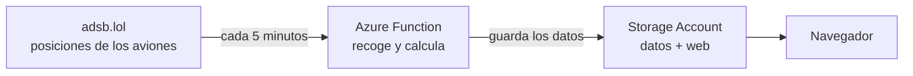
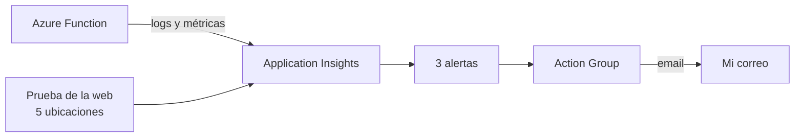

<p align="center">
  
</p>

<p align="center">
  Un mapa que se actualiza solo con los aviones que cruzan la Costa Brava.<br>
  Montado en Microsoft Azure, con toda la infraestructura escrita en Terraform.
</p>

<p align="center">
  <a href="#cómo-funciona">Cómo funciona</a>
  &nbsp;·&nbsp;
  <a href="#parte-técnica">Parte técnica</a>
  &nbsp;·&nbsp;
  <a href="#monitorización-y-alertas">Monitorización y alertas</a>
  &nbsp;·&nbsp;
  <a href="#problemas-que-me-encontré">Problemas que me encontré</a>
</p>

<p align="center">
  
  
  
  
</p>

> **Nota:** la demo en directo está apagada para no generar costes en Azure. Las capturas son del radar funcionando; se vuelve a poner en marcha en unos minutos con `bash desplegar.sh` (ver [Desplegarlo](#desplegarlo)).

<p align="center">
  
</p>

---

## Qué es

Por encima de la Costa Brava pasan aviones a todas horas: los que bajan a El Prat, los que salen de Girona y los que cruzan hacia el resto de Europa. Este proyecto los enseña en un mapa en tiempo real.

Abres la web y ves cada avión con su nombre de vuelo, hacia dónde va y a qué altura. El color indica si vuela bajo (seguramente despegando o aterrizando), a media altura o a altura de crucero. Si pulsas uno, te dice la aerolínea, el modelo, la matrícula y a qué velocidad va.

<p align="center">
  
</p>

Además el radar lleva la cuenta del día: cuántos aviones distintos han pasado, cuál ha volado más alto, cuál más rápido, a qué hora hubo más tráfico y qué aerolíneas se han visto más.

<p align="center">
  
</p>

Nadie tiene que tocar nada. Funciona solo, de día y de noche.

## Cómo funciona



Explicado sin tecnicismos:

1. Los aviones emiten constantemente su posición por radio. Hay redes de voluntarios con antenas que recogen esas señales y las publican gratis en internet. Este radar usa una de ellas, [adsb.lol](https://adsb.lol).
2. Cada 5 minutos se ejecuta un pequeño programa en la nube de Microsoft (una *Azure Function*). Pide los aviones que hay en la zona y actualiza las estadísticas del día.
3. Guarda el resultado en un almacenamiento en la nube (una *Storage Account*), que es también donde vive la web.
4. Cuando alguien abre la web, esta lee los últimos datos y pinta el mapa. Entre una lectura y la siguiente, cada avión se va moviendo según su rumbo y su velocidad, para que el mapa no se quede congelado.

## Lo que hay en Azure

Todo está dentro de un grupo de recursos, en la región France Central:

<p align="center">
  
</p>

| Recurso | Para qué lo uso |
|---|---|
| **Function App** (plan de consumo) | Ejecuta el programa que recoge los aviones cada 5 minutos |
| **Plan de App Service** (Y1) | El plan de consumo de la función: solo se paga lo que se ejecuta |
| **Storage Account** | Guarda los datos del radar y publica la web (*static website*) |
| **Application Insights** + **Log Analytics** | Logs de cada ejecución, para ver si algo falla |
| **Action Group** + **3 alertas** | Me mandan un email si el radar se para, si la función falla o si la web no responde |
| **Prueba de disponibilidad** | Abre la web desde 5 sitios de Europa cada 15 minutos |
| **Workbook** | Un panel con la salud de la función: ejecuciones, errores, duración y aviones |
| **Presupuesto** | Me avisa por email si el gasto pasa de 5 € al mes |

Nada de esto está creado a mano desde el portal. Todo sale de Terraform: [`infra/main.tf`](infra/main.tf) con la aplicación y [`infra/monitorizacion.tf`](infra/monitorizacion.tf) con la monitorización. Así el proyecto entero se monta o se borra con un comando.

---

## Parte técnica

### Estructura del repositorio

```
├── function/
│   ├── function_app.py    la Azure Function (Python)
│   ├── requirements.txt
│   └── host.json
├── infra/
│   ├── main.tf            la infraestructura de la aplicación
│   └── monitorizacion.tf  alertas, prueba de la web y Workbook
├── web/
│   ├── index.html         la web
│   ├── app.js             mapa y panel (Leaflet, sin frameworks)
│   └── estilo.css
├── docs/img/              capturas de este README
├── desplegar.sh           crea la infraestructura y sube el código
└── borrar.sh              elimina todo de Azure
```

### La función

Es una Azure Function en Python 3.11 con un *timer trigger* (`0 */5 * * * *`). En cada ejecución:

1. Llama a la API de adsb.lol (`/v2/point/41.85/2.65/60`), que devuelve los aviones en un radio de 60 millas náuticas. Después recorta al rectángulo que me interesa: `41.2–42.5 N` y `1.9–3.4 E`, de El Prat a Portbou.
2. Convierte las unidades de aviación a unidades normales:

   | Dato | Viene en | Lo guardo en |
   |---|---|---|
   | Altitud | pies | metros (× 0,3048) |
   | Velocidad | nudos | km/h (× 1,852) |
   | Velocidad vertical | pies/minuto | m/s (× 0,00508) |

3. Saca la aerolínea de las tres primeras letras del indicativo (código OACI: `VLG` es Vueling, `RYR` es Ryanair) y el país del prefijo de la matrícula (`EC-` es España, `D-` Alemania).
4. Actualiza el registro del día, con un apunte por avión: altura y velocidad máximas, y cuántas lecturas lleva a la vista.
5. Calcula el resumen del día y escribe tres JSON en el contenedor `$web` de la Storage Account:
   - `datos/live.json`: la última lectura y el resumen, que es lo que pinta la web.
   - `datos/dias/AAAA-MM-DD.json`: el detalle del día.
   - `datos/historial.json`: aviones distintos de los últimos 7 días.
6. Borra el detalle de los días de hace más de una semana, para que el almacenamiento no crezca sin control.

Así queda un avión en `live.json` (un Vueling descendiendo cerca de Barcelona):

```json
{
  "id": "345614",
  "vuelo": "VLG4DX",
  "aerolinea": "Vueling",
  "pais": "España",
  "matricula": "EC-MUM",
  "modelo": "A320",
  "lat": 41.5271,
  "lon": 1.9281,
  "altura_m": 3040,
  "en_tierra": false,
  "kmh": 586,
  "rumbo": 106,
  "subida": -6.5
}
```

Si adsb.lol no responde, la función prueba con OpenSky como plan B. Si tampoco responde ninguna de las dos, registra un aviso y lo vuelve a intentar 5 minutos después, sin dejar la web rota.

### La web

Es HTML, CSS y JavaScript sin frameworks, con el mapa de [Leaflet](https://leafletjs.com) sobre OpenStreetMap. Se sirve desde la propia Storage Account (*static website*), en el mismo dominio que los JSON. Por eso no hace falta una API ni configurar CORS: la web lee los archivos directamente.

Cada minuto vuelve a pedir `live.json`. Entre lecturas, calcula cada segundo la posición estimada de cada avión con su rumbo y su velocidad. Arriba a la derecha enseña el estado del sistema (más abajo, en [Monitorización y alertas](#monitorización-y-alertas)). Se adapta al móvil y al modo oscuro.

### Infraestructura (Terraform)

El archivo `infra/main.tf` crea:

- `azurerm_resource_group`
- `azurerm_storage_account` + `azurerm_storage_account_static_website`
- `azurerm_log_analytics_workspace` con un límite diario de 0,1 GB, para no salir nunca de la capa gratuita
- `azurerm_application_insights` conectado a ese workspace
- `azurerm_service_plan` (Linux, `Y1`, consumo) + `azurerm_linux_function_app`
- `azurerm_consumption_budget_resource_group`, solo si se pasa un email

Algunos detalles:

- Los nombres llevan un sufijo aleatorio (`random_string`), porque los nombres de Storage Account y Function App tienen que ser únicos en todo Azure.
- `WEBSITE_RUN_FROM_PACKAGE` está en `ignore_changes`. Azure añade ese ajuste al subir el código, y sin esto Terraform lo borraría en el siguiente `apply`.
- El código de la función se compila en Azure (`--build-remote`), así que no hace falta tener Python instalado para desplegar.

### Coste

Menos de 1 € al mes:

- La función usa unas 8.600 ejecuciones al mes, y el primer millón es gratis.
- La web estática no necesita ningún servidor.
- Log Analytics tiene un tope diario de ingesta.
- Los datos antiguos se borran solos.
- Lo único que se paga son unos 0,50 $ al mes de la alerta de logs (detalle en [Lo que cuesta vigilarlo](#lo-que-cuesta-vigilarlo)).
- Si algo se dispara, el presupuesto avisa por email.

---

## Monitorización y alertas

Que la web funcione el día que la monto no sirve de mucho si una semana después se para y no me entero. Así que le he puesto vigilancia, para poder responder a la pregunta de "¿cómo sabes que está caído?" sin tener que abrir la web cada día.

### Qué vigilo y por qué

Hay tres cosas que pueden ir mal, y vigilo cada una por separado:

1. **Que el radar deje de recoger aviones.** Es lo más importante: si la función no guarda datos, la web se queda congelada aunque cargue. Cada vez que la función guarda datos bien, deja en el log una línea `Radar: 25 aviones ahora, 61 hoy`. Si pasan 15 minutos sin ninguna (tendría que haber 3), algo pasa.
2. **Que la función dé errores.** Puede fallar por un cambio en la API, un problema con el Storage o un error mío en el código. Application Insights cuenta cada ejecución que acaba en error.
3. **Que la web no cargue.** Azure abre la web desde 5 sitios distintos de Europa cada 15 minutos. Si falla desde 3 o más a la vez, la web está caída de verdad. Si falla desde uno solo, seguramente es la red de ese sitio.



### Las alertas

| Alerta | Qué detecta | Tipo | Cada cuánto se comprueba | Qué hago cuando salta |
|---|---|---|---|---|
| **El radar se ha parado** | Ninguna recogida correcta en 15 minutos | Logs (consulta KQL) | Cada 15 min, sobre los últimos 15 min | Miro en el Workbook si la función se ejecuta. Si se ejecuta pero no guarda, reviso en los logs si adsb.lol y OpenSky responden |
| **Fallos en la recogida** | Alguna ejecución terminada con error | Métricas (`requests/failed`) | Cada 5 min, sobre los últimos 15 min | Busco la excepción en Application Insights (*Failures*) y corrijo el código o la configuración |
| **La web no responde** | La web falla desde 3 de las 5 ubicaciones | Métricas (prueba de disponibilidad) | Cada 5 min; la prueba corre cada 15 min | Compruebo que el Storage Account existe y que el *static website* sigue activado |

Las tres se cierran solas cuando el problema desaparece, y entonces llega otro email avisando de que todo ha vuelto a la normalidad.

Las alertas solo se crean si al desplegar se pasa un email (`EMAIL=...`). El email no está escrito en ningún archivo del repositorio: llega a Terraform como variable (`email_alertas`).

**¿Por qué una de logs y dos de métricas?** Las alertas de métricas usan contadores que Azure ya calcula solo (peticiones fallidas, disponibilidad), son casi instantáneas y gratis hasta 10. Pero no sirven para detectar que *algo no ha pasado*: si la función deja de ejecutarse, no hay métricas que mirar. Para eso hace falta una alerta de logs, que ejecuta una consulta y salta cuando no encuentra nada:

```kusto
traces
| where message startswith "Radar:"
```

Si esa consulta devuelve 0 filas en 15 minutos, salta.

### El estado en la web

La propia web también enseña si el sistema va bien, con un punto de color junto a la hora de la última actualización. Lo calcula con la fecha que la función guarda en `live.json`:

| Color | Significa |
|---|---|
| Verde: **Funcionando** | Datos de hace menos de 10 minutos |
| Amarillo: **Con retraso** | Entre 10 y 15 minutos: se ha saltado alguna lectura |
| Rojo: **Radar parado** | Más de 15 minutos, el mismo límite que la alerta |

<!-- Captura del indicador: docs/img/estado-web.png
<p align="center">
  
</p>
-->

### El Workbook "Radar Costa Brava – Salud"

Es un panel de Azure Monitor con cuatro gráficos, también creado con Terraform:

- **Ejecuciones por hora**, correctas y fallidas. Tienen que salir 12 por hora.
- **Errores y avisos por hora.** Los avisos suelen ser que adsb.lol no ha contestado y se ha usado OpenSky.
- **Duración de la función.** Si sube mucho respecto a lo normal, alguna de las APIs va lenta.
- **Aviones detectados por hora**, que sale de la misma línea `Radar: N aviones...` del log.

Está en el portal, en *Monitor → Workbooks* (o dentro del Application Insights → *Workbooks*).

<!-- Captura del Workbook: docs/img/workbook.png
<p align="center">
  
</p>
-->

### Cómo probar una alerta

La función tiene un ajuste `SIMULAR_FALLO`. Si está en `true`, cada ejecución falla a propósito y no guarda datos. Desde Cloud Shell:

```bash
GRUPO=rg-radar-costabrava
FUNCION=$(terraform -chdir=infra output -raw funcion)

# 1. Romperlo a propósito
az functionapp config appsettings set -g $GRUPO -n $FUNCION --settings SIMULAR_FALLO=true

# 2. Esperar. En 5-10 minutos llega "Fallos en la recogida",
#    en unos 15-30 "El radar se ha parado", y la web se pone en amarillo y luego en rojo.

# 3. Arreglarlo
az functionapp config appsettings set -g $GRUPO -n $FUNCION --settings SIMULAR_FALLO=false
```

Al volver a `false`, las alertas se cierran solas y llega el email de "Resolved". Si se me olvida volver a ponerlo en `false`, el siguiente `bash desplegar.sh` lo deja bien, porque Terraform lo tiene en `false`.

<!-- Captura del email: docs/img/email-alerta.png
<p align="center">
  
</p>
-->

### Lo que cuesta vigilarlo

| Pieza | Coste |
|---|---|
| Application Insights + Log Analytics | 0 €, con tope de ingesta de 0,1 GB al día |
| 2 alertas de métricas | 0 €, Azure regala 10 series de métricas vigiladas al mes |
| Alerta de logs cada 15 minutos | unos 0,50 $ al mes |
| Prueba de la web (ping clásica) | 0 € |
| Workbook y emails (1.000 gratis al mes) | 0 € |

La prueba de la web tiene truco. La prueba *ping* clásica es gratis, pero Microsoft la retira el 30 de septiembre de 2028. La que la sustituye, la prueba *estándar*, se cobra por ejecución: con 5 ubicaciones cada 15 minutos saldrían unos 7 $ al mes, más que todo el resto del proyecto junto. Por eso de momento uso la clásica. Cuando la retiren, cambiaré a la estándar desde una sola ubicación (alrededor de 1,5 $ al mes) o la quitaré.

---

## Problemas que me encontré

Ningún despliegue sale a la primera. Estos son los problemas reales que tuve y cómo los resolví:

**La región no aceptaba cuentas nuevas.** Al crear los recursos en West Europe, Azure respondía `RequestDisallowedByAzure`: esa región no estaba admitiendo clientes nuevos. Cambié la variable `region` de Terraform a France Central y volví a aplicar.

**Un nombre de Storage "atascado".** Al mover el proyecto de región, Azure seguía dando por ocupado el nombre del Storage Account que acababa de borrar, y la creación fallaba con un 404. Lo solucioné forzando un sufijo nuevo con `terraform taint random_string.sufijo`, así todos los recursos se recrearon con nombres nuevos.

**La API de vuelos bloqueaba a Azure.** Al principio usaba OpenSky. Desde Cloud Shell respondía bien, pero la función no escribía ningún dato. En los logs de Application Insights apareció el motivo: *timeouts*, porque OpenSky bloquea muchas peticiones que salen de Azure Functions. Cambié a adsb.lol como fuente principal y dejé OpenSky como plan B. De paso gané datos que OpenSky no daba, como el modelo de avión y la matrícula.

**El mapa de fondo pedía una clave.** El primer mapa base (CARTO) salía con una marca de agua de "API KEY REQUIRED" fuera de local. Lo cambié por OpenStreetMap, con un filtro CSS para que quede en gris oscuro tipo pantalla de radar.

Además, `desplegar.sh` reintenta `terraform apply` y la subida de la función si Azure devuelve un error pasajero justo después de crear algo.

Y al añadir la monitorización:

**"Correcta" no quiere decir "con datos".** Mi primera idea fue que la alerta del radar parado contara las ejecuciones correctas de la función. Pero si adsb.lol y OpenSky fallan a la vez, la función registra un aviso y termina *bien*, sin guardar nada. Para Azure sería una ejecución correcta, aunque la web se quedara congelada. Por eso la alerta busca la línea `Radar: N aviones...`, que solo se escribe cuando los datos se han guardado.

**Azure no acepta una ventana de 20 minutos.** Quería que la alerta mirase los últimos 20 minutos (4 ejecuciones), pero `terraform validate` falló con `expected window_duration to be one of ["PT1M" "PT5M" "PT10M" "PT15M" "PT30M"...], got PT20M`. Las alertas de logs solo admiten ciertos valores, así que la dejé en 15 minutos.

**El muestreo de Application Insights.** En `host.json` el muestreo estaba activado para todo menos las peticiones. Con poco tráfico casi nunca descarta nada, pero si descartara justo la línea `Radar:...`, saltaría la alerta sin motivo. He sacado también las trazas y las excepciones del muestreo, y para este volumen no cambia el coste.

**Las pruebas de disponibilidad gratis están de salida.** La prueba *ping* clásica, la gratuita, está marcada como obsoleta, y la nueva cuesta dinero (ver [Lo que cuesta vigilarlo](#lo-que-cuesta-vigilarlo)). Como de momento se sigue pudiendo usar, me quedé con la gratuita y dejé apuntado qué hacer cuando la retiren.

## Desplegarlo

Hace falta una suscripción de Azure. Desde **Azure Cloud Shell** (Bash), que ya trae Terraform y Azure CLI:

```bash
# sube el proyecto a Cloud Shell y luego:
cd radar-costa-brava
EMAIL=tu@correo.com bash desplegar.sh
```

El script registra los proveedores necesarios, crea la infraestructura, sube la web y la función y, al final, muestra la dirección del radar. Los primeros aviones aparecen en menos de 5 minutos.

El email es opcional: sirve para el aviso de presupuesto y para las alertas. Sin `EMAIL` se despliega igual, pero sin alertas.

Para borrarlo todo:

```bash
bash borrar.sh
```

## Qué mejoraría

- Guardar el estado de Terraform en un backend remoto (Storage Account), en vez de en local.
- Pasar la prueba de la web a una prueba *estándar* antes de que retiren la clásica en 2028.
- Detectar despegues y aterrizajes en El Prat y Girona a partir de la velocidad vertical.
- Un pipeline de GitHub Actions para desplegar con cada `push`.
- Repetir el día entero a cámara rápida con los datos guardados.

## Créditos

- Datos de vuelos: [adsb.lol](https://adsb.lol) (licencia ODbL).
- Mapa: © [OpenStreetMap](https://www.openstreetmap.org/copyright) y su comunidad.
- Mapa interactivo: [Leaflet](https://leafletjs.com).

---

<p align="center">Proyecto de <b>Pau Miró Fàbregas</b></p>
