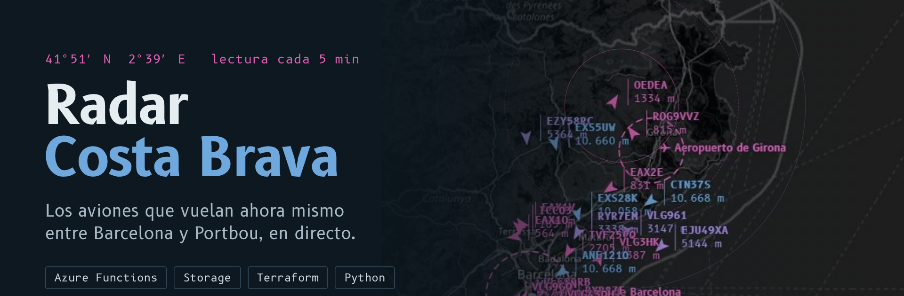
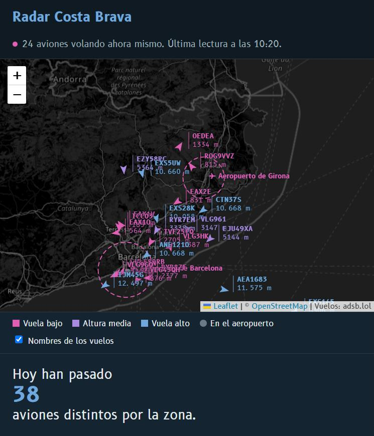
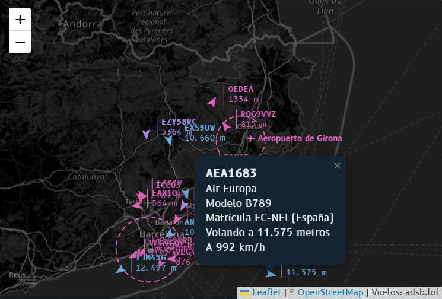
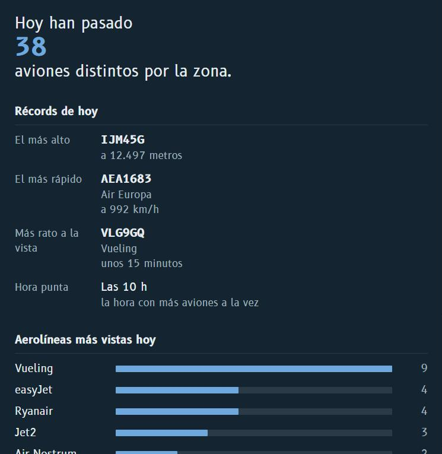
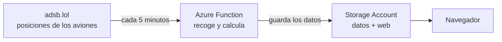
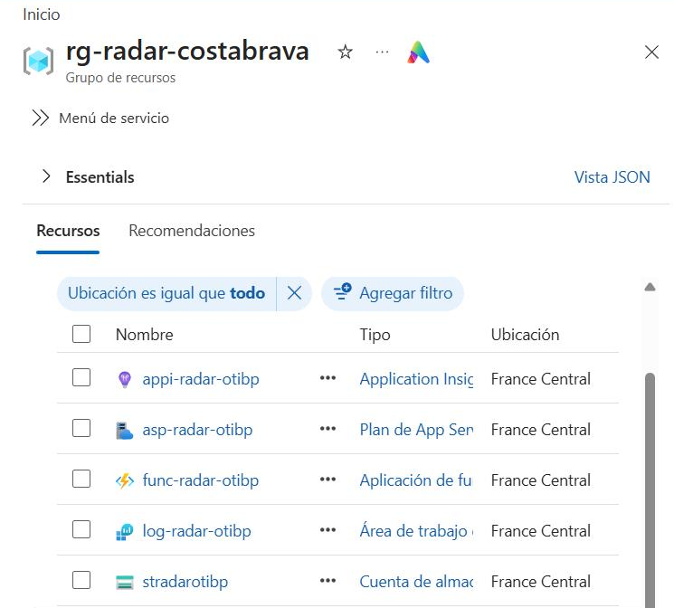

<p align="center">
  
</p>

<p align="center">
  Un mapa que se actualiza solo con los aviones que cruzan la Costa Brava.<br>
  Montado en Microsoft Azure, con toda la infraestructura escrita en Terraform.
</p>

<p align="center">
  <a href="https://stradarotibp.z28.web.core.windows.net/"><b>Ver el radar en directo</b></a>
  &nbsp;·&nbsp;
  <a href="#cómo-funciona">Cómo funciona</a>
  &nbsp;·&nbsp;
  <a href="#parte-técnica">Parte técnica</a>
  &nbsp;·&nbsp;
  <a href="#problemas-que-me-encontré">Problemas que me encontré</a>
</p>

<p align="center">
  
  
  
  
</p>

<p align="center">
  
</p>

---

## Qué es

Por encima de la Costa Brava pasan aviones a todas horas: los que bajan a El Prat, los que salen de Girona y los que cruzan hacia el resto de Europa. Este proyecto los enseña en un mapa en tiempo real.

Abres la web y ves cada avión con su nombre de vuelo, hacia dónde va y a qué altura. El color indica si vuela bajo (seguramente despegando o aterrizando), a media altura o a altura de crucero. Si pulsas uno, te dice la aerolínea, el modelo, la matrícula y a qué velocidad va.

<p align="center">
  
</p>

Además el radar lleva la cuenta del día: cuántos aviones distintos han pasado, cuál ha volado más alto, cuál más rápido, a qué hora hubo más tráfico y qué aerolíneas se han visto más.

<p align="center">
  
</p>

Nadie tiene que tocar nada. Funciona solo, de día y de noche.

## Cómo funciona



Explicado sin tecnicismos:

1. Los aviones emiten constantemente su posición por radio. Hay redes de voluntarios con antenas que recogen esas señales y las publican gratis en internet. Este radar usa una de ellas, [adsb.lol](https://adsb.lol).
2. Cada 5 minutos se ejecuta un pequeño programa en la nube de Microsoft (una *Azure Function*). Pide los aviones que hay en la zona y actualiza las estadísticas del día.
3. Guarda el resultado en un almacenamiento en la nube (una *Storage Account*), que es también donde vive la web.
4. Cuando alguien abre la web, esta lee los últimos datos y pinta el mapa. Entre una lectura y la siguiente, cada avión se va moviendo según su rumbo y su velocidad, para que el mapa no se quede congelado.

## Lo que hay en Azure

Todo está dentro de un grupo de recursos, en la región France Central:

<p align="center">
  
</p>

| Recurso | Para qué lo uso |
|---|---|
| **Function App** (plan de consumo) | Ejecuta el programa que recoge los aviones cada 5 minutos |
| **Plan de App Service** (Y1) | El plan de consumo de la función: solo se paga lo que se ejecuta |
| **Storage Account** | Guarda los datos del radar y publica la web (*static website*) |
| **Application Insights** + **Log Analytics** | Logs de cada ejecución, para ver si algo falla |
| **Presupuesto** | Me avisa por email si el gasto pasa de 5 € al mes |

Nada de esto está creado a mano desde el portal. Todo sale de un único archivo de Terraform, [`infra/main.tf`](infra/main.tf), así que el proyecto entero se monta o se borra con un comando.

---

## Parte técnica

### Estructura del repositorio

```
├── function/
│   ├── function_app.py    la Azure Function (Python)
│   ├── requirements.txt
│   └── host.json
├── infra/
│   └── main.tf            toda la infraestructura
├── web/
│   ├── index.html         la web
│   ├── app.js             mapa y panel (Leaflet, sin frameworks)
│   └── estilo.css
├── docs/img/              capturas de este README
├── desplegar.sh           crea la infraestructura y sube el código
└── borrar.sh              elimina todo de Azure
```

### La función

Es una Azure Function en Python 3.11 con un *timer trigger* (`0 */5 * * * *`). En cada ejecución:

1. Llama a la API de adsb.lol (`/v2/point/41.85/2.65/60`), que devuelve los aviones en un radio de 60 millas náuticas. Después recorta al rectángulo que me interesa: `41.2–42.5 N` y `1.9–3.4 E`, de El Prat a Portbou.
2. Convierte las unidades de aviación a unidades normales:

   | Dato | Viene en | Lo guardo en |
   |---|---|---|
   | Altitud | pies | metros (× 0,3048) |
   | Velocidad | nudos | km/h (× 1,852) |
   | Velocidad vertical | pies/minuto | m/s (× 0,00508) |

3. Saca la aerolínea de las tres primeras letras del indicativo (código OACI: `VLG` es Vueling, `RYR` es Ryanair) y el país del prefijo de la matrícula (`EC-` es España, `D-` Alemania).
4. Actualiza el registro del día, con un apunte por avión: altura y velocidad máximas, y cuántas lecturas lleva a la vista.
5. Calcula el resumen del día y escribe tres JSON en el contenedor `$web` de la Storage Account:
   - `datos/live.json`: la última lectura y el resumen, que es lo que pinta la web.
   - `datos/dias/AAAA-MM-DD.json`: el detalle del día.
   - `datos/historial.json`: aviones distintos de los últimos 7 días.
6. Borra el detalle de los días de hace más de una semana, para que el almacenamiento no crezca sin control.

Así queda un avión en `live.json` (un Vueling descendiendo cerca de Barcelona):

```json
{
  "id": "345614",
  "vuelo": "VLG4DX",
  "aerolinea": "Vueling",
  "pais": "España",
  "matricula": "EC-MUM",
  "modelo": "A320",
  "lat": 41.5271,
  "lon": 1.9281,
  "altura_m": 3040,
  "en_tierra": false,
  "kmh": 586,
  "rumbo": 106,
  "subida": -6.5
}
```

Si adsb.lol no responde, la función prueba con OpenSky como plan B. Si tampoco responde ninguna de las dos, registra un aviso y lo vuelve a intentar 5 minutos después, sin dejar la web rota.

### La web

Es HTML, CSS y JavaScript sin frameworks, con el mapa de [Leaflet](https://leafletjs.com) sobre OpenStreetMap. Se sirve desde la propia Storage Account (*static website*), en el mismo dominio que los JSON. Por eso no hace falta una API ni configurar CORS: la web lee los archivos directamente.

Cada minuto vuelve a pedir `live.json`. Entre lecturas, calcula cada segundo la posición estimada de cada avión con su rumbo y su velocidad. Se adapta al móvil y al modo oscuro.

### Infraestructura (Terraform)

El archivo `infra/main.tf` crea:

- `azurerm_resource_group`
- `azurerm_storage_account` + `azurerm_storage_account_static_website`
- `azurerm_log_analytics_workspace` con un límite diario de 0,1 GB, para no salir nunca de la capa gratuita
- `azurerm_application_insights` conectado a ese workspace
- `azurerm_service_plan` (Linux, `Y1`, consumo) + `azurerm_linux_function_app`
- `azurerm_consumption_budget_resource_group`, solo si se pasa un email

Algunos detalles:

- Los nombres llevan un sufijo aleatorio (`random_string`), porque los nombres de Storage Account y Function App tienen que ser únicos en todo Azure.
- `WEBSITE_RUN_FROM_PACKAGE` está en `ignore_changes`. Azure añade ese ajuste al subir el código, y sin esto Terraform lo borraría en el siguiente `apply`.
- El código de la función se compila en Azure (`--build-remote`), así que no hace falta tener Python instalado para desplegar.

### Coste

Prácticamente 0 €:

- La función usa unas 8.600 ejecuciones al mes, y el primer millón es gratis.
- La web estática no necesita ningún servidor.
- Log Analytics tiene un tope diario de ingesta.
- Los datos antiguos se borran solos.
- Si algo se dispara, el presupuesto avisa por email.

---

## Problemas que me encontré

Ningún despliegue sale a la primera. Estos son los problemas reales que tuve y cómo los resolví:

**La región no aceptaba cuentas nuevas.** Al crear los recursos en West Europe, Azure respondía `RequestDisallowedByAzure`: esa región no estaba admitiendo clientes nuevos. Cambié la variable `region` de Terraform a France Central y volví a aplicar.

**Un nombre de Storage "atascado".** Al mover el proyecto de región, Azure seguía dando por ocupado el nombre del Storage Account que acababa de borrar, y la creación fallaba con un 404. Lo solucioné forzando un sufijo nuevo con `terraform taint random_string.sufijo`, así todos los recursos se recrearon con nombres nuevos.

**La API de vuelos bloqueaba a Azure.** Al principio usaba OpenSky. Desde Cloud Shell respondía bien, pero la función no escribía ningún dato. En los logs de Application Insights apareció el motivo: *timeouts*, porque OpenSky bloquea muchas peticiones que salen de Azure Functions. Cambié a adsb.lol como fuente principal y dejé OpenSky como plan B. De paso gané datos que OpenSky no daba, como el modelo de avión y la matrícula.

**El mapa de fondo pedía una clave.** El primer mapa base (CARTO) salía con una marca de agua de "API KEY REQUIRED" fuera de local. Lo cambié por OpenStreetMap, con un filtro CSS para que quede en gris oscuro tipo pantalla de radar.

Además, `desplegar.sh` reintenta `terraform apply` y la subida de la función si Azure devuelve un error pasajero justo después de crear algo.

## Desplegarlo

Hace falta una suscripción de Azure. Desde **Azure Cloud Shell** (Bash), que ya trae Terraform y Azure CLI:

```bash
# sube el proyecto a Cloud Shell y luego:
cd radar-costa-brava
EMAIL=tu@correo.com bash desplegar.sh
```

El script registra los proveedores necesarios, crea la infraestructura, sube la web y la función y, al final, muestra la dirección del radar. Los primeros aviones aparecen en menos de 5 minutos.

Para borrarlo todo:

```bash
bash borrar.sh
```

## Qué mejoraría

- Guardar el estado de Terraform en un backend remoto (Storage Account), en vez de en local.
- Una alerta de Azure Monitor si la función falla varias veces seguidas.
- Detectar despegues y aterrizajes en El Prat y Girona a partir de la velocidad vertical.
- Un pipeline de GitHub Actions para desplegar con cada `push`.
- Repetir el día entero a cámara rápida con los datos guardados.

## Créditos

- Datos de vuelos: [adsb.lol](https://adsb.lol) (licencia ODbL).
- Mapa: © [OpenStreetMap](https://www.openstreetmap.org/copyright) y su comunidad.
- Mapa interactivo: [Leaflet](https://leafletjs.com).

---

<p align="center">Proyecto de <b>Pau Miró Fàbregas</b></p>
